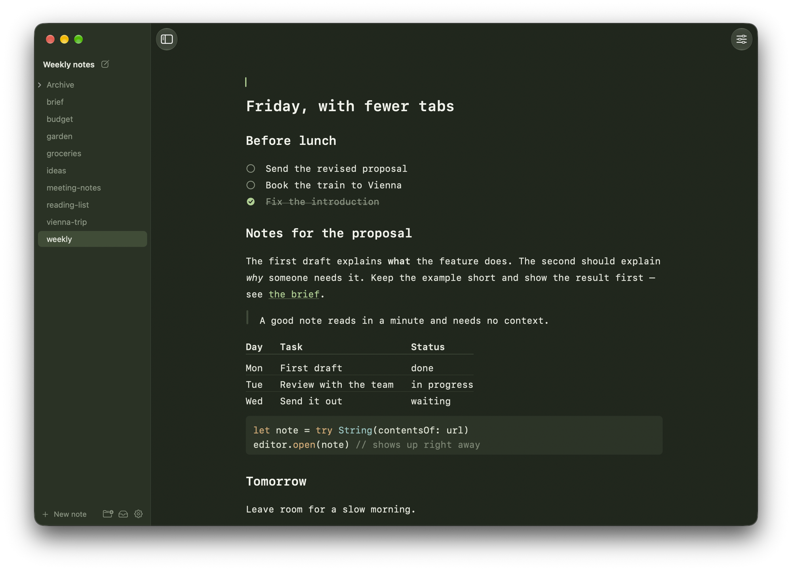

# Meadow

A simple, light and fast native Markdown notes editor for macOS.



- Notes are plain `.md` files in a folder; the sidebar shows the folder as it is.
- Live preview: Markdown (`#`, `**`, `[]()`, `|`) is hidden and appears only in the block under the cursor.
- `- [ ]` tasks are drawn as circles and toggled with a click; tables line up in columns; code is highlighted.
- Autosave, picks up changes made by other apps, Quick Look for `.md` files in Finder.
- JSON files open too, as highlighted source (sidebar, Finder “Open With”, Quick Look).
- Swift + AppKit (TextKit 1), no web view; parsing by `cmark-gfm`.

Landing page with benchmarks: [`site/index.html`](site/index.html).

## Speed

Measured on a MacBook Pro (M4 Pro), medians; details and code in [`bench/`](bench/).

| | Meadow | TextEdit | Antigravity IDE | Xcode | Obsidian |
|---|---|---|---|---|---|
| Cold launch → window | **311 ms** | 314 ms | 912 ms | 2,912 ms | 377 ms |
| Memory with a note open | **47 MB** | 65 MB | 1,334 MB | 330 MB | 856 MB |

## Build and install

You need Xcode and [XcodeGen](https://github.com/yonaskolb/XcodeGen) (`brew install xcodegen`).

```sh
./scripts/install.sh        # Release build into /Applications/Meadow.app
```

For development:

```sh
xcodegen generate && open Meadow.xcodeproj
cd Packages/MeadowKit && swift test
```

Set your own `DEVELOPMENT_TEAM` in `project.yml` to sign the app and its Quick Look extension.

To open `.md` files with a double-click: Finder → Get Info on a file → Open with → Meadow → Change All.

## How it is built

- `Packages/MeadowKit` — the editor engine:
  - `MarkdownAnalysis.swift` — parses with `cmark-gfm` into lines, spans and leaf blocks (UTF-16 offsets, works around known cmark position bugs);
  - `MarkdownStyler.swift` — text attributes from the analysis, applied incrementally to changed blocks only;
  - `MarkdownLayoutManager.swift` — hides markers at the glyph level, draws task circles, aligns tables, draws code backgrounds and quote bars;
  - `MarkdownTextView.swift` (+`Editing`) — the editor: reveals Markdown under the cursor, toggles tasks, continues lists on Return and Tab.
- `App/` — window, sidebar, autosave, FSEvents, settings.
- `QuickLook/` — the preview extension.
- `bench/` — the app benchmark and the landing page generator.

## License

MIT, see [LICENSE](LICENSE).
